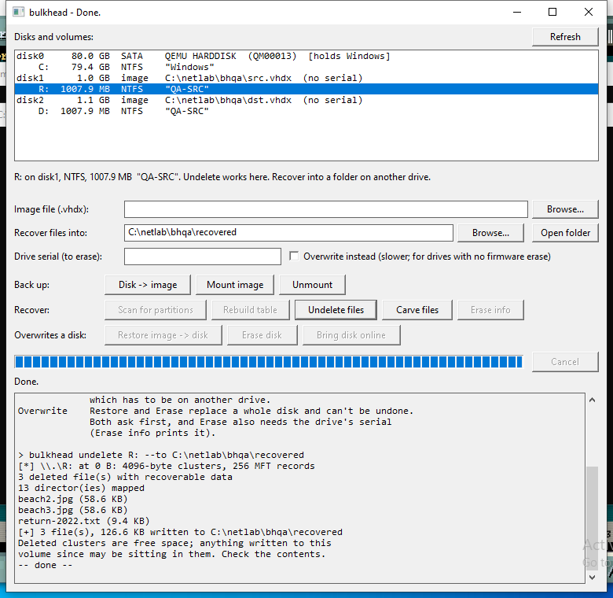

# bulkhead

A free, MIT-licensed disk tool for Windows. It images disks to plain VHDX and
restores them, rebuilds lost partition tables, recovers deleted NTFS files,
reads ext4, XFS and HFS+ volumes that Windows can't, and erases drives with a
certificate of erasure. It comes as a command-line exe and a native window,
and it builds its own bootable WinPE recovery ISO.

## Status

**v0.1.0, alpha.** Every command has been run against real disks or VMs, but
not every path has been run on every kind of hardware. `restore`,
`erase`, `part move` and `scan --rebuild` write to disks and can't be undone:
read what they print before saying yes.

**Conformance: 9 of 10 checks pass** locally and in CI (`tools/conformance.ps1`):
real ext2/ext4/XFS/HFS+ images made by each filesystem's own `mkfs`, read back
and hashed, mounted as drives, and the image/restore/move/rebuild/undelete/carve
stages on throwaway disks. A check that stops passing fails the build.

Proven on real hardware or VMs:

- **Undelete at scale.** After an `rm -rf` on an 18 TB NTFS volume, 815,472
  files (432.6 GB) came back into their directory tree, including 238 git
  repositories with 2 corrupt objects among them ([details](docs/recovery.md#what-this-has-been-run-against)).
- **Image, wipe, rebuild, restore.** A 238 GB laptop drive with 8 partitions was
  imaged and wiped; `scan --rebuild` found 7 of the 8 at their exact offsets
  (the 8th, Microsoft Reserved, holds no filesystem to find).
- **Restore to bare metal**, from the recovery media, in a VM: a restored
  Debian disk booted to a login prompt.
- **ATA SANITIZE purge** on a 512 GB SATA SSD, with a certificate that reads
  Purge.
- **HFS+ and HFSX volumes made by macOS**, every file matching macOS's own `md5`.

Not yet: NVMe erase, the system disk of a physical machine end to end,
BitLocker (images as ciphertext), and `verify`. What's next is in
[ROADMAP.md](ROADMAP.md); what changed is in [CHANGELOG.md](CHANGELOG.md).

## Screenshots



Reading a Linux root filesystem that Windows won't mount:

```
> bulkhead ls debian-root.img
[*] debian-root.img at 0 B: ext4, 2.9 GB
       38.6 MB  boot/  615 files
        1.5 MB  etc/  932 files
         732 B  root/  2 files
      571.5 MB  usr/  20348 files
        9.0 MB  var/  1659 files
           7 B  bin
           9 B  lib64
[*] 20 entries here, 23560 files in all, 620.6 MB
```

`find | wc -l` on the machine the filesystem came from says 23560 too.

## Getting Started

### Quick start

1. Download `bulkhead-gui.exe` and `bulkhead.exe` from the
   [latest release](https://github.com/sp00nznet/bulkhead/releases/latest)
   into **the same folder**. The window runs `bulkhead.exe` for every
   operation, so it needs it next to it.
2. Right-click `bulkhead-gui.exe` and choose **Run as administrator**. Reading
   disks directly needs it.
3. The window lists your disks. Pick one and press the button for the job.

There's nothing to install. Windows SmartScreen may warn about an unsigned
download: **More info**, then **Run anyway**.

### Step by step (command line)

Needs Windows 10 or 11, 64-bit. Nothing else, except
[WinFsp](https://winfsp.dev/) for `mount-fs` and the
[Windows ADK](https://aka.ms/adk) for `media`.

1. Download `bulkhead.exe` from the
   [latest release](https://github.com/sp00nznet/bulkhead/releases/latest).
2. Open **Terminal (Admin)** or an elevated PowerShell in that folder. Without
   elevation, commands that open a disk or volume fail with
   `Access is denied`. Reading an image file doesn't need it.
3. See what's attached, without changing anything:
   ```
   .\bulkhead.exe identify disk0
   ```
   It prints the partition table and what's on each partition.
4. Run `.\bulkhead.exe` with no arguments for every command and its options.

## Usage

```
bulkhead image <VOL|diskN> <OUT.vhdx> [--from <PARENT.vhdx>] [--no-snapshot]
bulkhead mount <IMAGE.vhdx> [--rw]
bulkhead unmount <IMAGE.vhdx>
bulkhead restore <IMAGE.vhdx> <diskN> [--yes]
bulkhead part list <diskN>
bulkhead part move <diskN> <N> --to <OFFSET> [--yes]
bulkhead scan <diskN> [--rebuild] [--yes]
bulkhead undo <diskN> <TABLE.bin> [--yes]
bulkhead undelete <VOL|diskN> --to <DIR> [--at <OFFSET>] [--limit <N>] [--flat]
bulkhead carve <VOL|diskN> --to <DIR> [--limit <N>]
bulkhead identify <VOL|diskN> [--at <OFFSET>]
bulkhead ls <VOL|diskN|IMAGE> [PATH] [--at <OFFSET>]
bulkhead cp <VOL|diskN|IMAGE> <PATH> --to <DIR> [--at <OFFSET>]
bulkhead mount-fs <VOL|diskN|IMAGE> <X:> [--at <OFFSET>]
bulkhead erase-info <diskN>
bulkhead erase <diskN> [--method <M>] [--yes] [--cert <FILE>]
bulkhead media <OUT.iso>
bulkhead gui
```

```powershell
# image the system volume live, then an incremental on top of it
bulkhead image C: D:\backups\c-full.vhdx
bulkhead image C: D:\backups\c-mon.vhdx --from D:\backups\c-full.vhdx

# bootable recovery media (needs the Windows ADK and its WinPE add-on)
bulkhead media D:\bulkhead-recovery.iso

# a partition table got wiped: find the filesystems, then write a new table
bulkhead scan disk2
bulkhead scan disk2 --rebuild

# get deleted files back off an NTFS volume, into their original folders
bulkhead undelete E: --to D:\recovered

# copy files off a Linux disk. identify says where its partition starts
bulkhead identify disk3
bulkhead ls disk3 --at 1MB /home/me
bulkhead cp disk3 /home/me/photos --to D:\photos --at 1MB

# what can this drive do to erase itself, then do it, with a certificate
bulkhead erase-info disk4
bulkhead erase disk4 --cert D:\erase-disk4.html
```

Each area has its own page:

| | |
|---|---|
| [Imaging and recovery media](docs/imaging.md) | `image`, `mount`, `restore`, `media`, and the measured sizes |
| [Partitioning](docs/partitioning.md) | `part list`, `part move`, and what's left to Windows |
| [Data recovery](docs/recovery.md) | `scan` a lost partition table, `undelete` from NTFS, `carve` from raw bytes |
| [Reading ext4, XFS and HFS+](docs/filesystems.md) | `ls`, `cp`, `mount-fs`, and how they're verified |
| [What is this disk?](docs/identify.md) | `identify`: RAID, LVM, ZFS, btrfs and friends |
| [Secure erase](docs/secure-erase.md) | `erase-info`, `erase`, and the certificate |
| [The window](docs/gui.md) | `bulkhead gui` |
| [Architecture](docs/architecture.md) | the parts, why the window is a separate process, why VHDX |
| [Design notes](docs/design.md) | shortcuts taken, granularity numbers, known limits |

### Compared with what's sold

Checked 2026-10-22, from third-party listings where vendors don't publish prices.

| Job | Paid option | bulkhead |
|---|---|---|
| Disk imaging | Macrium Reflect Free reached end of life in January 2024; Reflect X Home is about $45-50 a year per PC. Acronis True Image is subscription-only, from $49.99 a year. AOMEI Backupper Standard, MiniTool ShadowMaker Free and EaseUS Todo Free still image and restore for free, and charge for cloning, scheduling and media extras | Images and restores to VHDX, which opens without bulkhead. No scheduler: run it from Task Scheduler |
| Linux filesystems on Windows | Paragon Linux File Systems for Windows, about $30. It also writes ext4 and reads btrfs, which bulkhead doesn't | Reads ext4, XFS and HFS+, and mounts ext4 and XFS as a drive letter |
| Drive erasure with a report | Blancco Drive Eraser, sold per drive per year (about $7-18 a drive through resellers) | ATA SANITIZE and overwrite, with a certificate. NVMe isn't proven yet, and the certificate isn't signed |

Sources: [gHacks](https://www.ghacks.net/?p=182006) on Reflect Free,
[PCWorld](https://www.pcworld.com/article/3204158/macrium-reflect-x-home-review-2.html) on Reflect X,
[Acronis](https://www.acronis.com/en-us/products/true-image/purchasing/),
[Paragon](https://www.paragon-software.com/home/linuxfs-windows/) and
[FileHorse](https://www.filehorse.com/download-linux-file-systems-for-windows/),
[CDW](https://www.cdw.com/product/blancco-drive-eraser-enterprise-edition-subscription-license-1-year-1/8183818),
[PCWorld](https://pcworld.com/article/2853116/aomei-backupper-standard-review.html) on AOMEI.

## Building from source

1. Install [Rust](https://rustup.rs/) (stable, 1.85 or newer for edition 2024)
   with the MSVC toolchain, which needs the Visual Studio Build Tools' "Desktop
   development with C++" workload.
2. Build:
   ```
   git clone https://github.com/sp00nznet/bulkhead
   cd bulkhead
   cargo build --release
   ```
   Both executables land in `target\release\`.
3. Check it, as CI does:
   ```
   cargo fmt --check
   cargo clippy --locked --all-targets -- -D warnings
   cargo test --locked
   ```
4. The conformance harness needs more than a build. `fs-smoke.ps1` needs WSL
   with the `mkfs` tools. `smoke.ps1` needs an elevated prompt and creates and
   destroys its own throwaway VHDX disks. See [CONTRIBUTING.md](CONTRIBUTING.md).

`.cargo/config.toml` links the C runtime statically and loads `comctl32.dll`
lazily. WinPE has neither DLL, and without these flags the recovery media's
binary dies before printing anything.

## Related

The same idea as [futureburn](https://github.com/sp00nznet/futureburn) (disc
burning and ripping), [pstfree](https://github.com/sp00nznet/pstfree) (Outlook
PST/OST without Outlook) and [vncfree](https://github.com/sp00nznet/vncfree):
read the published spec, call the OS API that's already there, ship one
executable. Why that's worth doing is in [PHILOSOPHY.md](PHILOSOPHY.md).

## License

MIT. See [LICENSE](LICENSE). Security issues: [SECURITY.md](SECURITY.md).
